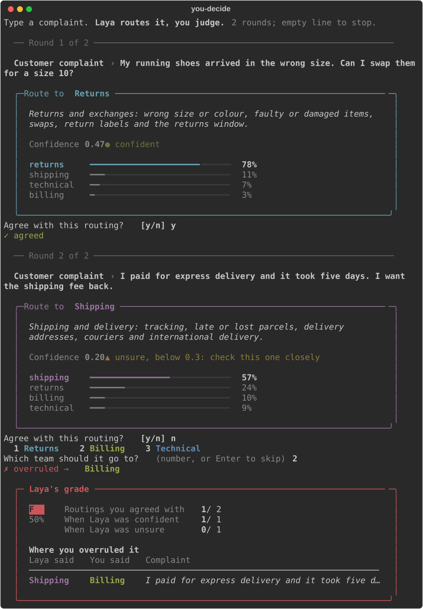

# you-decide

A *decision model* answers a question by choosing among options you give it, rather than by writing text. You send it a situation and a question with a fixed set of answers; it returns a number for each answer and a measure of how sure it is. It does not act. Your code reads the numbers and decides what happens. This project shows that pattern inside a small application, as described in [*decision models are not new*](https://www.kriskang.com/blog/decision-models-are-not-new) (also on LinkedIn as [*You Decide*](https://www.linkedin.com/pulse/you-decide-kris-kang-o9hpc/)): the model scores, the code decides, and a person judges the result. Everything runs locally (no API key, nothing is billed).

## What it does

You type a customer complaint. [Laya](https://huggingface.co/convaiinnovations/laya), an open decision model, chooses which of four support teams should handle it. The application shows the choice, the team's scope as the reason, how sure the model is, and how it weighed every team. You say whether you agree. After ten complaints, Laya gets a grade.



The grade is split by whether Laya was confident or unsure, so you can see whether its confidence means anything. Every routing you overruled is listed with the team you chose instead. The screenshot is a real session.

## What this teaches

The application is small. The shape is the point. Four things carry over to any decision model and any application:

- **The application owns the options.** The teams and their scopes live in code. The model only scores which scope fits; it cannot invent a fifth team.
- **The explanation cannot be hallucinated.** The reason shown is the chosen team's scope, written by a person. The model writes no prose, so there is nothing to make up.
- **Doubt is a line of code.** `UNSURE_BELOW = 0.3` is a constant you can read, review, and test. A rule written into a prompt is none of these.
- **A threshold catches only the errors a model knows about.** Given bare team names, Laya sends a wrong-size complaint to Shipping with high confidence, above the threshold. Given the scopes, it picks Returns. Posing the question well comes first, and that is code too.

[ARCHITECTURE.md](./ARCHITECTURE.md) follows one decision through the code, step by step.

## Why Laya, not Jev

The article is about Jev, TypeSafe's hosted decision model. This demo runs Laya instead.

NB: I chose Laya so that anyone can run the demo in two commands. Its weights are open (Apache-2.0) and run on a laptop: no account, no API key, and no bill. Complaints you type never leave your machine. And the shape is the same: Laya answers the same typed questions with the same fields, and its bundled server speaks Jev's `/v1/systemone` protocol. The application code is what carries over, and it does not care which model fills in the answer.

The trade-offs are real. TypeSafe claims a new architecture and calibration training for Jev; this demo uses Laya's base checkpoint, untuned, with known calibration problems. Laya also computes confidence differently, so the article's 0.3 threshold is a starting point here, not a value carried over. Read the grades as a floor for the pattern, not a verdict on Jev. To run on Jev, write one backend class; [ARCHITECTURE.md](./ARCHITECTURE.md) shows how.

## Scope

This is a toy, not an evaluation. Ten rounds, one person, and complaints you write yourself are too few to measure a model. The aim is practical: to show how a decision model fits into an application, where the model stops and the code starts, and how a person stays in the loop. Treat it as a template.

Do not read it as: a benchmark of Laya, a comparison of Laya and Jev, or a production routing system. The grade describes your session, nothing wider.

## Running it

Requires Python 3.11 or 3.12 and [uv](https://docs.astral.sh/uv/). Runs on Apple Silicon, CUDA, or CPU. The first run downloads the model (up to about 2 GB).

```bash
uv sync              # install (exact pinned versions)
uv run you-decide    # play ten rounds
scripts/check.sh     # lint, format, type check, tests; no model needed
```

`--rounds N` changes the length; an empty line stops early. Sessions are saved to `sessions/` (git-ignored). `uv run python scripts/screenshot.py` regenerates the screenshot.

## Documents

- [ARCHITECTURE.md](./ARCHITECTURE.md): how it works inside, the Laya caveats, security, and CI.
- [AGENTS.md](./AGENTS.md): rules for agents in the repo, and how to add a team.
- [GLOSSARY.md](./GLOSSARY.md): every term in plain language.

## License

MIT. See [LICENSE](./LICENSE).
